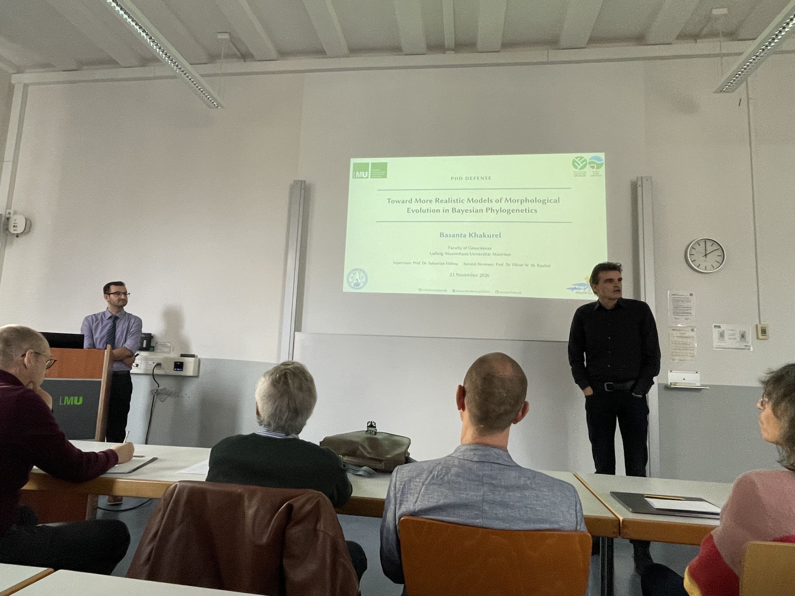
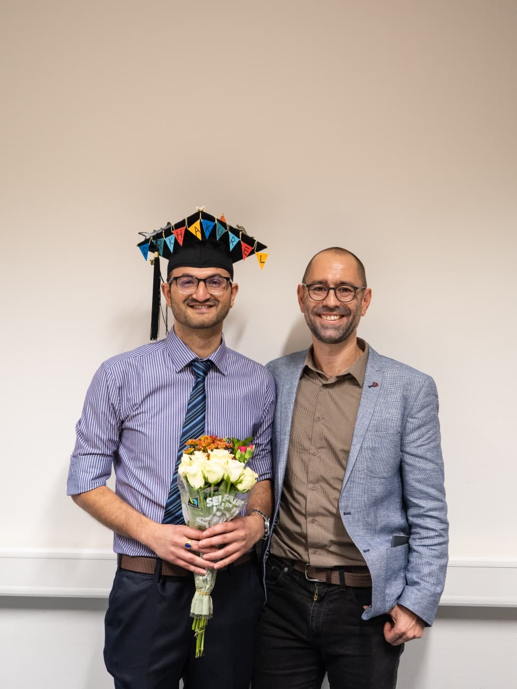

<header class="page-header">
  <h2 class="page-title">Big Congratulations to Dr. Basanta</h2>
   
</header>

  

Earlier this week, Basanta successfully defended his PhD thesis titled **'Towards More Realistic Models of Morphological Evolution in Bayesian Phylogenetics'**. Congrats, Dr. Khakurel!

Basanta's research sheds light on the nature of morphological evolution and how existing methods for phylogenetic tree inference using morphological data make strong assumptions about the evolutionary processes.
A highlight of his work is the `Covariomorph` model, which allows morphological characters to evolve at different rates in different parts of the tree.

Since joining the Höhna lab in 2023, Basanta has been actively involved in our lab and beyond — not only did he take up responsibilities such as maintaining our lab website, he has almost never missed a social gathering! 🍻
We will for sure miss your presence, as well as your quick wit and humor. At the same time, we are excited to see you embarking on the next stage of your research journey!
